<!-- ═════════════════════════ BOOT SEQUENCE ═════════════════════════ -->
<p align="center">
  <a href="https://coaxus.dev"></a>
</p>

<p align="center">
  
</p>

<p align="center">
  <a href="https://coaxus.dev"></a>
  <a href="https://www.instagram.com/codewcoaxus"></a>
  <a href="https://www.tiktok.com/@codewcoaxus"></a>
</p>

<p align="center">
  
  <a href="https://wakatime.com/@51cd1d0d-64a0-44b7-ac35-28eac0a0a33e"></a>
  <a href="https://github.com/ellerbrock/open-source-badge/"></a>
</p>

---

<!-- ═════════════════════════ PLAYER 1 ═════════════════════════ -->
## ▶ PLAYER 1

<p align="center">
  
</p>

<details>
<summary><b>💾 LOAD SAVE FILE — <code>julian.py</code></b></summary>
<br />

```python
from dataclasses import dataclass
from typing import List


@dataclass(frozen=True)
class EngineerProfile:
    name: str
    role: str
    focus: List[str]
    languages: List[str]

    def press_start(self) -> str:
        return f"PLAYER 1 READY: {self.name}. Let's build something that lasts."


julian = EngineerProfile(
    name="Julian Trujillo",
    role="Software Engineer",
    focus=[
        "Scalable backend systems",
        "Clean Architecture & DDD",
        "Modern frontend experiences",
        "DevOps & cloud-native infrastructure",
    ],
    languages=["Spanish (native)", "English (B2)"],
)

print(julian.press_start())
```

</details>

I design and build **robust, production-grade systems** with a strong emphasis on architecture, maintainability, and performance. Comfortable owning projects end-to-end — from domain modeling and backend services to frontend UX and deployment pipelines.

---

<!-- ═════════════════════════ RULES OF THE GAME ═════════════════════════ -->
## 🎮 RULES OF THE GAME

<table>
  <tr>
    <td align="center" width="25%">🏛️<br /><b>ARCHITECTURE FIRST</b><br /><sub>SOLID · Hexagonal · DDD</sub></td>
    <td align="center" width="25%">⏳<br /><b>CODE THAT SURVIVES TIME</b><br /><sub>Readability over cleverness</sub></td>
    <td align="center" width="25%">🔭<br /><b>SYSTEMS THINKING</b><br /><sub>Scalability · Observability · Fault tolerance</sub></td>
    <td align="center" width="25%">🎯<br /><b>UX MATTERS</b><br /><sub>Engineering serves users</sub></td>
  </tr>
</table>

> I care more about the decisions made before writing code than the code itself.
> Structure, boundaries, and intent — get those right, and everything else follows.

---

<!-- ═════════════════════════ INVENTORY ═════════════════════════ -->
## 🧰 INVENTORY

<table align="center">
  <tr>
    <td align="right"><code>WEAPONS</code></td>
    <td></td>
  </tr>
  <tr>
    <td align="right"><code>ARMOR</code></td>
    <td></td>
  </tr>
  <tr>
    <td align="right"><code>MAGIC</code></td>
    <td></td>
  </tr>
  <tr>
    <td align="right"><code>VEHICLES</code></td>
    <td></td>
  </tr>
</table>

---

<!-- ═════════════════════════ SAVE FILES ═════════════════════════ -->
## 💾 SAVE FILES

<p align="center">
  
</p>

---

<!-- ═════════════════════════ HIGH SCORES ═════════════════════════ -->
## 🏆 HIGH SCORES

<p align="center">
  
  
</p>

<p align="center">
  
</p>

<p align="center">
  
</p>

<p align="center">
  <picture>
    <source media="(prefers-color-scheme: dark)" srcset="https://raw.githubusercontent.com/coaxus-ux/coaxus-ux/output/github-snake-dark.svg" />
    <source media="(prefers-color-scheme: light)" srcset="https://raw.githubusercontent.com/coaxus-ux/coaxus-ux/output/github-snake.svg" />
    
  </picture>
</p>

---

<!-- ═════════════════════════ WORLD MAP ═════════════════════════ -->
## 🗺️ WORLD MAP — what you'll find here

| LEVEL | ZONE |
|:--:|---|
| `1-1` | ✅ Production-ready architectures |
| `1-2` | 🧭 Opinionated but pragmatic code |
| `1-3` | 🧪 Experiments with systems, languages, and tooling |
| `1-4` | 🏗️ Long-term projects, not throwaway demos |

---

<!-- ═════════════════════════ CONTINUE? ═════════════════════════ -->
<p align="center">
  <a href="https://coaxus.dev"></a>
</p>

<p align="center">
  <sub>⭐ Explore the repositories or visit <a href="https://coaxus.dev"><b>coaxus.dev</b></a></sub>
</p>
